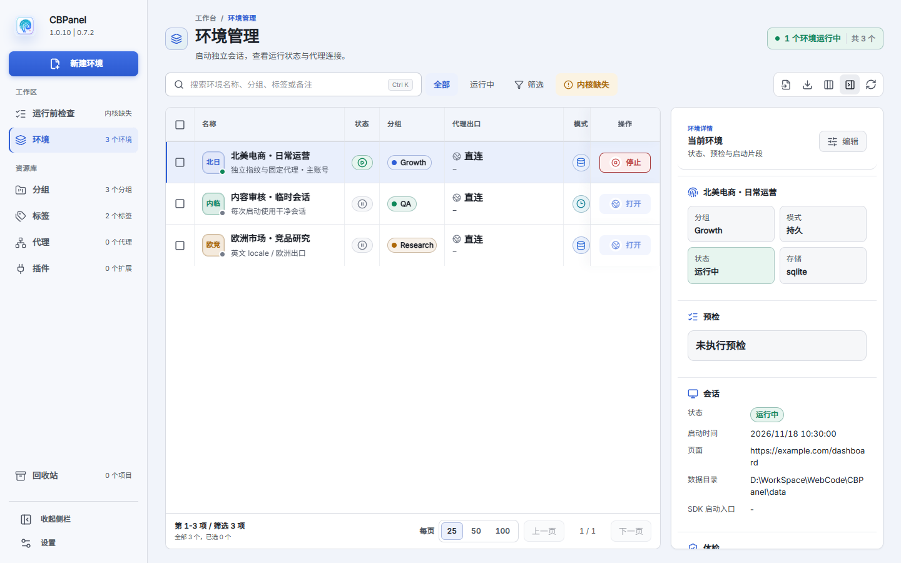

# CBPanel

[中文说明](README.zh-CN.md)

CBPanel is a local Web + Desktop management shell for [CloakBrowser](https://github.com/CloakHQ/CloakBrowser/).



## Compatibility Note

The development and CI toolchain requires Node.js 26 or newer (with npm 11 or newer) and Rust 1.90.0 or newer for the Tauri desktop shell. Only the Windows portable build has been tested. Other artifacts are provided as-is and are not guaranteed to work.

## Quick Start

```bash
npm install
npm run dev
```

For a clean, lockfile-respecting install, use `npm ci`.

The development server runs at:

```text
http://127.0.0.1:4173
```

Useful checks:

```bash
npm run typecheck
npm test
npm run build
```

Desktop commands:

```bash
npm run desktop:dev
npm run desktop:portable
npm run release:windows
npm run release:linux
npm run release:mac
```

### Windows toolchain

Windows artifacts always target `x86_64-pc-windows-msvc`. The build scripts pick the MSVC toolchain themselves (an explicit `CBPANEL_RUSTC` first, then the MSVC rustc under scoop's `rust` / `%USERPROFILE%\.cargo`, and PATH only as a last resort), so a machine carrying both scoop `rust` and `rust-gnu` no longer produces a gnu artifact by accident.

If the PATH `rustc -vV` host is not msvc and no MSVC toolchain is found, `sidecar:build`, `desktop:build`, `desktop:portable` and `release:windows` fail instead of silently emitting gnu. For local debugging only, `CBPANEL_ALLOW_NON_MSVC=1` skips the check — do not publish that artifact.

## Downloads

Artifacts are published on the [GitHub Releases](https://github.com/lkeme/CBPanel/releases) page.

| Platform | Artifact |
| --- | --- |
| Windows | Installer `.exe` or portable `.zip` |
| Linux | x64 `.AppImage` |
| macOS | `.dmg` |

Releases are cut by `.github/workflows/release.yml`: push a `v*` tag (for example `v1.0.10`), or run the workflow manually to publish the `package.json` version. Each tag produces its own release and older releases stay available.

Linux:

```bash
chmod +x CBPanel-linux-x64.AppImage
./CBPanel-linux-x64.AppImage
```

## Deviations from the upstream docs

CBPanel only exposes configuration the [CloakBrowser docs](https://github.com/CloakHQ/CloakBrowser/) describe. Every deliberate deviation — plus the CBPanel extensions that are not upstream behaviour at all, the version gates, and the sync checklist — is documented in [docs/UPSTREAM-DEVIATIONS.en.md](docs/UPSTREAM-DEVIATIONS.en.md). Read that file when troubleshooting or before syncing upstream.

## License

- **CBPanel** — MIT. See [LICENSE](LICENSE).
- **CloakBrowser wrapper code** — MIT. See [CloakBrowser LICENSE](https://github.com/CloakHQ/CloakBrowser/blob/main/LICENSE).
- **CloakBrowser binary** (compiled Chromium) — free to use, no redistribution. See [BINARY-LICENSE.md](https://github.com/CloakHQ/CloakBrowser/blob/main/BINARY-LICENSE.md).
