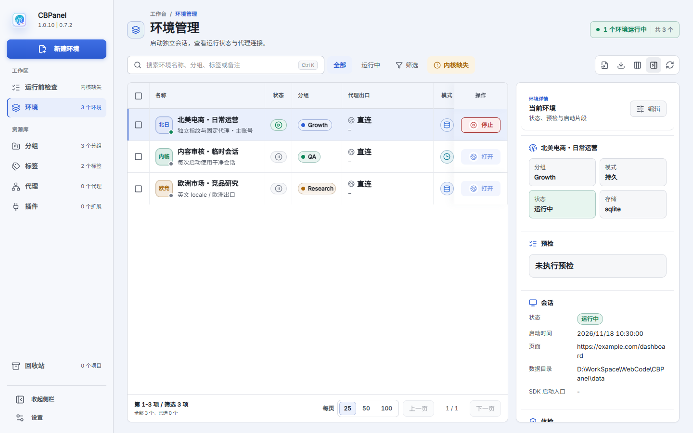

# CBPanel

[English](README.md)

CBPanel 是 [CloakBrowser](https://github.com/CloakHQ/CloakBrowser/) 的本地 Web + Desktop 管理壳程序。



## 兼容性说明

开发和 CI 工具链要求 Node.js 26 或更高版本（npm 11 或更高版本），Tauri 桌面壳要求 Rust 1.90.0 或更高版本。目前只测试过 Windows 便携版；其他产物按当前状态提供，不保证可用。

## 快速开始

```bash
npm install
npm run dev
```

如需严格按锁文件安装依赖，请使用 `npm ci`。

开发服务默认运行在：

```text
http://127.0.0.1:4173
```

常用检查：

```bash
npm run typecheck
npm test
npm run build
```

桌面端命令：

```bash
npm run desktop:dev
npm run desktop:portable
npm run release:windows
npm run release:linux
npm run release:mac
```

### Windows 工具链

Windows 产物固定使用 `x86_64-pc-windows-msvc`。构建脚本会自己挑选 MSVC 工具链（先看 `CBPANEL_RUSTC`，再找 scoop `rust` / `%USERPROFILE%\.cargo` 下的 MSVC rustc，最后才回落到 PATH），因此同时装了 scoop 的 `rust` 和 `rust-gnu` 也不会误产出 gnu 产物。

如果 PATH 上的 `rustc -vV` 报告的 host 不是 msvc，且找不到可用的 MSVC 工具链，`sidecar:build`、`desktop:build`、`desktop:portable`、`release:windows` 都会直接失败而不是静默产出 gnu。仅本地调试时可设 `CBPANEL_ALLOW_NON_MSVC=1` 跳过该检查——这种产物不要发布。

## 下载

产物发布在 [GitHub Releases](https://github.com/lkeme/CBPanel/releases) 页面。

| 平台 | 产物 |
| --- | --- |
| Windows | 安装版 `.exe` 或便携版 `.zip` |
| Linux | x64 `.AppImage` |
| macOS | `.dmg` |

发布由 `.github/workflows/release.yml` 负责：推送 `v*` tag（例如 `v1.0.10`），或手动触发工作流以发布 `package.json` 中的版本号。每个 tag 生成独立 Release，历史版本保留。

Linux：

```bash
chmod +x CBPanel-linux-x64.AppImage
./CBPanel-linux-x64.AppImage
```

## 与上游文档的偏离

CBPanel 只按 [CloakBrowser 文档](https://github.com/CloakHQ/CloakBrowser/) 暴露配置面。所有有意偏离、不属于上游行为的 CBPanel 扩展、版本门槛与同步检查清单，统一记录在 [docs/UPSTREAM-DEVIATIONS.zh-CN.md](docs/UPSTREAM-DEVIATIONS.zh-CN.md)；排障与下次对齐上游前请先读该文件。

## 许可证

- **CBPanel** — MIT。见 [LICENSE](LICENSE)。
- **CloakBrowser wrapper 代码** — MIT。见 [CloakBrowser LICENSE](https://github.com/CloakHQ/CloakBrowser/blob/main/LICENSE)。
- **CloakBrowser binary**（编译后的 Chromium）— 可免费使用，不可再分发。见 [BINARY-LICENSE.md](https://github.com/CloakHQ/CloakBrowser/blob/main/BINARY-LICENSE.md)。
